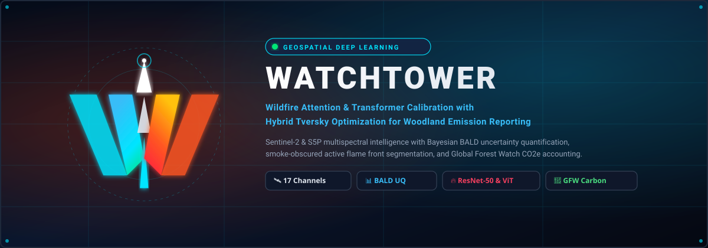

<p align="center">
  
</p>

<p align="center">
  <a href="#key-capabilities"></a>
  <a href="https://www.python.org/downloads/"></a>
  <a href="https://pytorch.org/"></a>
  <a href="https://opensource.org/licenses/MIT"></a>
</p>

# WATCHTOWER: Wildfire Attention & Transformer Calibration with Hybrid Tversky Optimization for Woodland Emission Reporting

An end-to-end geospatial deep learning system for high-resolution semantic segmentation of active flame fronts and burn scars, isolated Bayesian uncertainty quantification under heavy smoke obscuration, and uncertainty-propagated greenhouse gas ($\text{CO}_2\text{e}$) accounting via Global Forest Watch (GFW).

---

## Key Capabilities

1. **17-Channel Multispectral Input**:
   - 12 Sentinel-2 bands ($B_1 \dots B_{12}$) with asymmetric physical reflectance clipping ($B_1 \dots B_{10} \in [0.0, 1.0]$, SWIR $B_{11}, B_{12} \in [0.0, 2.0]$ to preserve active fire thermal radiation).
   - 1 Sentinel-5P UV Aerosol Index band ($B_{13} \in [-3.0, 8.0]$).
   - 4 Physical spectral indices: NBR, AF_SWIR, NDVI, NDWI.
2. **Heuristic Label Refinement**:
   - Refines coarse binary MODIS active fire labels into 3 semantic classes: Class 0 (Background / Smoke), Class 1 (Burn Scar), and Class 2 (Active Flame Front).
3. **SSL4EO First-Layer Weight Surgery**:
   - Adapts self-supervised pre-trained weights (`ssl4eo_l` 7-ch or `ssl4eo_s12` 13-ch) to 17 channels with Red-Edge interpolation, aerosol initialization, symmetric index differences, and variance-preserving scaling $C_{\text{pre}} / C_{\text{target}}$.
4. **Architectures (<16 GB VRAM Budget)**:
   - **Attention U-Net ResNet-50** (~26.25M params) with lateral $1\times 1$ bottleneck projections (`[2048, 1024, 512, 256, 64] -> [256, 192, 128, 64, 32]`).
   - **Compact ViT-S/16 Seg** (~24.32M params) with 2D bicubic positional embedding interpolation ($14\times 14 \to 16\times 16$) and a 4-stage progressive `ConvTranspose2d` decoder.
5. **FP32-Safe Wildfire Hybrid Loss**:
   - Multi-Class Focal ($\gamma = 2.0$) + Multi-Class Focal Tversky ($\alpha_{\text{FP}} = 0.30, \beta_{\text{FN}} = 0.70, \gamma = 1.3333$) + Multi-Class Lovász-Softmax Loss.
6. **Isolated Monte Carlo Dropout & BALD UQ**:
   - Evaluates in `.eval()` mode with only `Dropout`/`Dropout2d` modules active, preserving `BatchNorm2d` running statistics.
   - Decomposes uncertainty into total predictive entropy, aleatoric entropy, and epistemic mutual information.
7. **Smoke-Conditioned Calibration (Smoke-FCER)**:
   - Evaluates mIoU, macro-F1, NLL, Brier score, ECE, and AUSE across smoke-obscured and flame-boundary regions.
8. **GFW Biomass & Soil Carbon Accounting**:
   - Intersects vector burn scars with Global Forest Watch AGB ($\text{Mg/ha}$) and SOC ($\text{tC/ha}$) to report carbon loss and $\text{tCO}_2\text{e}$ across Conservative, Nominal, and Upper 95% CI regimes.
   - Tracks compute energy footprint with CodeCarbon (`Watchtower_UQ_Seg`).

---

## Quickstart

### 1. Environment Setup
```bash
# Clone and enter workspace
git clone https://github.com/altha/Watchtower.git
cd Watchtower

# Install dependencies using uv or pip
uv pip install -r requirements.txt
```

### 2. Run Automated Verification Test Suite (All 22 Unit Tests)
```bash
pytest -v
```

### 3. Run Automated Dry-Run Verification (Synthetic Tensors B=2, C=17, H=256, W=256)
```bash
python scripts/verify_pipeline_dryrun.py
```

### 4. Generate Diagnostic Visualization (8-Panel Demonstration)
```bash
python scripts/visualize_sample_inference.py
```
*Outputs diagnostic figure to `outputs/inference_visualization_demo.png`.*

### 5. Train & Evaluate
```bash
# Attention U-Net ResNet-50
python train_and_evaluate.py --architecture attention_unet_r50 --ssl_source ssl4eo_s12 --config configs/default_16gb_fp16.yaml --dry_run

# Compact ViT-S/16
python train_and_evaluate.py --architecture compact_vit_s16 --ssl_source ssl4eo_l --config configs/default_16gb_fp16.yaml --dry_run
```
*(Omit `--dry_run` for full GPU training on mounted datasets).*

